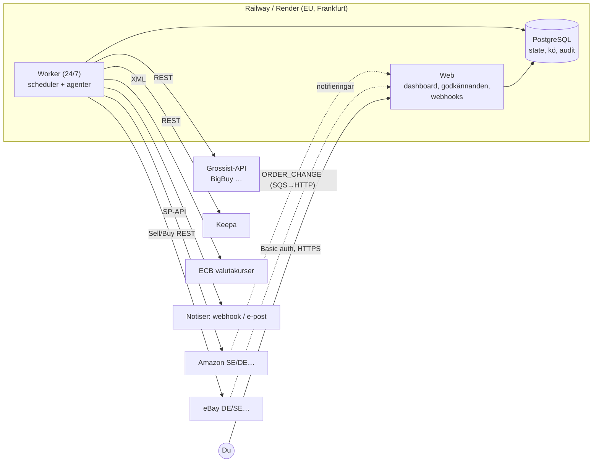

# Arkitektur

Två processer från samma image (`PROCESS=web|worker`), en Postgres. Postgres är databas, jobbkö (tillståndsmaskiner + `FOR UPDATE SKIP LOCKED`) och lås (advisory locks) – inga extra komponenter att drifta. Vercel passar inte som primär värd eftersom workern måste köra kontinuerligt; det går att lägga dashboarden där senare.

## Agenter (moduler i `src/agents`)

| Agent | Ansvar | Frekvens |
|---|---|---|
| Research (`research.ts`) | Hittar kandidater (Keepa Product Finder: mellanrank, få säljare, ej Amazon-retail), sparar efterfrågan, pris, konkurrens, rating, trend. | 4×/dygn |
| Procurement (`sourcing.ts`) | Matchar kandidater mot grossistkataloger på EAN, sparar pris, MOQ, lager, leveranstid, CE/GPSR-data; räknar leverantörspålitlighet. | 4×/dygn |
| Evaluation (`evaluation.ts`) | Compliance → verklig nettokalkyl → Opportunity Score → beslut (APPROVED / REJECTED / REQUIRES VERIFICATION) med förklaring. | varje timme |
| Listing (`listing.ts`) | Skapar listing endast från leverantörsfakta, lokaliserad text, juridisk info (tillverkare, EU-ansvarig, retur). Max 20 aktiva. | varje timme |
| Inventory (`inventory.ts`) | Lager/kostnad från leverantör, minskar antal vid lågt lager, pausar vid slut, pausar om kostnad gör priset olönsamt. | var 15:e min |
| Pricing (`pricing.ts`) | Följer konkurrent/Buy Box inom golv–tak, små steg, cool-down, jagar aldrig under golvet. | varje timme |
| Operations (`orders.ts`) | Order in → betalning → lager/pris/lönsamhet → bedrägeri → utgiftsgränser → leverantörsorder → tracking → marknadsplats → leveransbevakning. | var 5:e min + webhook |
| Account Health (`health.ts`) | Marknadsplatsens mått + egna mått; pausar listning/prissättning (och vid kritiskt läge försäljning) innan kontot riskeras. | var 4:e timme |
| Support (`support.ts`) | Returer, standardsvar (endast fakta ur DB), eskaleringsregler. | varje timme |
| Reporting (`reports.ts`) | Daglig rapport 07:00, veckostrategi måndag. | dagligen / veckovis |
| Ops (`ops.ts`) | Saknade nycklar → NEEDS OWNER ACTION, valutakurser, jobb som fallerar. | 30 min / 6 h |

## Beslutsregler (alla i `system_settings`, ändras i dashboarden)
Min nettomarginal 20 % · min vinst 80 SEK/order · min leverantörspålitlighet 85 · max returgrad 8 % · lagerbuffert 20 · max leveranstid 7 dagar · min Opportunity Score 65 · max 20 aktiva listings.

## Lönsamhetsmodell (`domain/profit.ts`)
Intäkt inkl. moms − moms − produktkostnad − leverantörsfrakt − tull − valutabuffert − marknadsplatsavgift − betalavgift − annonser − förväntad returkostnad − refund-reserv − reklamationsreserv − leverantörsavgifter − mjukvara = bidrag. Ger nettovinst, nettomarginal (på intäkt exkl. moms), ROI, break-even-pris, break-even-annonskostnad, max leverantörskostnad och **prisgolv** (lägsta pris som klarar både min-vinst och min-marginal). Golvet räknas om vid varje kostnadsändring.

## Idempotens och återstart
- `orders UNIQUE(marketplace, external_order_id)` – samma order kan hämtas hur många gånger som helst.
- `supplier_orders UNIQUE(order_id)` + `idempotency_key` skrivs och **committas innan** leverantörs-API anropas. Krasch mitt i → `reconcile` letar upp ordern hos leverantören via referens; systemet beställer **aldrig** om automatiskt.
- POST-anrop som kan ha lyckats (nätverksfel/5xx) görs aldrig om automatiskt.
- `transactions UNIQUE(kind, source_ref)` – ekonomi bokas en gång.
- Jobb körs under Postgres advisory lock (flera repliker säkert); `job_runs` gör att föräldralösa körningar syns efter omstart.

## Säkerhetsregler
1. Secrets endast i värdens krypterade variabler; `redact()` i loggning; Fastify loggar aldrig Authorization.
2. Webbinnehåll/leverantörstext = **data, aldrig instruktioner**: saneras, LLM-prompt isolerar i `<facts>`, genererad text valideras (inga nya siffror/påståenden) annars mall.
3. Inga lösenord, 2FA, BankID, CAPTCHA eller KYC hanteras av systemet – sådant görs av dig. Ingen browserautomation mot Amazon/eBay.
4. Dashboard bakom Basic auth över HTTPS, CSRF-skydd (Origin-kontroll), all output HTML-escapad.
5. Spend limits (dag, order, öppna leverantörsordrar, kassabuffert, refund) → annars godkännande. Global nödstopp-knapp.
6. Stegvis live (`GO_LIVE_STAGE`): 0 bara research → 1 listning → 2 automatiska ordrar → 3 prissättning → 4 full.
7. Kunddata minimeras: adress hämtas just-in-time till leverantören, lagras inte; köpare pseudonymiseras; eBay-kontoradering anonymiserar.

## Datamodell
Se `src/db/migrations/001_init.sql`: products, product_research, product_scores, suppliers, supplier_products, listings, marketplaces, orders, order_items, supplier_orders, shipments, customers, returns, pricing_history, inventory_history, competitor_data, fees, transactions, profit_calculations, compliance_checks, alerts, approval_requests, agent_actions, audit_logs, system_settings, job_runs, reports, exchange_rates.
